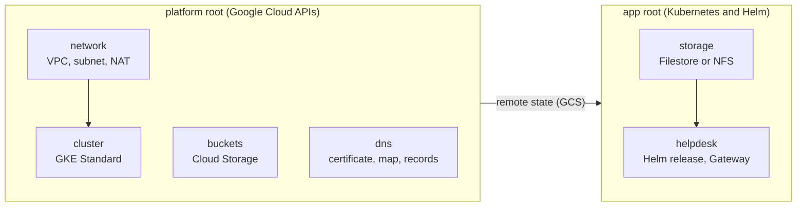

# helpdesk-gcp

OpenTofu / Terraform code that deploys [DuploCloud](https://duplocloud.com) **Helpdesk** into your own Google Cloud
project: a VPC, a private GKE cluster, shared storage, Cloud Storage buckets, a Google-managed certificate
with DNS, and the Helpdesk Helm release behind a Gateway API load balancer.

Every layer can be **created** or can **adopt** something you already have: an existing VPC and subnet,
GKE cluster, Filestore instance, bucket or certificate map. Adopted resources are read, never modified, so
the same code serves a new project (greenfield) and one with an established platform (brownfield).

The repository works on its own, and it is also what the DuploCloud DevKit's Cloud Deployment agent runs.
It follows the same layout and contract as
[`terraform-aws-helpdesk`](https://github.com/duplocloud/terraform-aws-helpdesk).

- [Architecture](#architecture)
- [Requirements](#requirements)
- [Quick start](#quick-start)
- [Repository layout](#repository-layout)
- [Configuration](#configuration)
- [Resource naming](#resource-naming)
- [Outputs](#outputs)
- [Destroying a deployment](#destroying-a-deployment)
- [Security](#security)
- [Tests](#tests)
- [Contributing](#contributing)
- [Terraform and OpenTofu](#terraform-and-opentofu)
- [License](#license)

## Architecture



| Layer | Root | Module | Creates | AWS counterpart |
|---|---|---|---|---|
| `network` | platform | `vpc` | VPC, node subnet with Pod and Service ranges, proxy-only subnet, Cloud Router and NAT, firewall | `vpc` |
| `cluster` | platform | `gke` | Regional GKE Standard with private nodes, Workload Identity, Filestore CSI driver, node pool | `eks` |
| `buckets` | platform | `gcs` | App-data and user-data buckets (uniform access, public access prevented) | `s3` |
| `dns` | platform | `dns` | Certificate Manager certificate and map, DNS authorizations, Cloud DNS records | `dns` |
| `storage` | app | `storage` | NFS provisioner for an existing Filestore share (other modes are handled by the chart) | `efs` + `addons` |
| `helpdesk` | app | `helpdesk` | Namespace, Workload Identity service accounts, gateway IP, SSL policy, A records, Helm release | `helpdesk` |

There are two roots because the `app` root configures its Kubernetes and Helm providers from a cluster that
must already exist. Apply `platform` first, then `app`; `app` reads the platform outputs from the platform
state with `terraform_remote_state`.

## Requirements

- OpenTofu 1.10 or later (CI and the DevKit agent run 1.13). Terraform 1.10+ also works but is not tested here.
- A GCS bucket for state. The agent uses `duplo-helpdesk-tfstate-<project_id>`, versioned, with uniform
  access.
- A DuploCloud Helpdesk license token.
- Google credentials for the target project with these roles:

| Role | Needed for |
|---|---|
| `roles/serviceusage.serviceUsageAdmin` | Enabling the required APIs |
| `roles/compute.admin` | VPC, subnets, router, NAT, firewall, reserved IP, SSL policy |
| `roles/container.admin` | GKE cluster and node pool, Kubernetes and Helm resources (also on an adopted cluster) |
| `roles/file.editor` | The Filestore instance the CSI driver creates (`filestore` storage mode) |
| `roles/storage.admin` | Helpdesk buckets and their IAM |
| `roles/iam.serviceAccountAdmin` | Node and workload service accounts, Workload Identity bindings |
| `roles/iam.serviceAccountUser` | Attaching the node service account to the node pool |
| `roles/resourcemanager.projectIamAdmin` | Project IAM bindings for those service accounts |
| `roles/dns.admin` | Records in the Cloud DNS zone (on the zone's project) |
| `roles/certificatemanager.owner` | Certificate, DNS authorizations, certificate map |

## Quick start

Example inputs for a new project are in [`examples/greenfield/`](examples/greenfield/). Replace
`my-gcp-project`, the hostnames and the Cloud DNS zone with your own.

```bash
# 1. platform
cd platform
cat > backend.hcl <<EOF
bucket = "duplo-helpdesk-tfstate-my-gcp-project"
prefix = "deployments/hd/platform"
EOF
tofu init -backend-config=backend.hcl
tofu plan -var-file=../examples/greenfield/platform.tfvars.json -out=platform.tfplan
tofu apply platform.tfplan

# 2. app
cd ../app
sed 's#/platform"#/app"#' ../platform/backend.hcl > backend.hcl
tofu init -backend-config=backend.hcl
export TF_VAR_secrets='{"licensing_token":"...","local_admin_password":"..."}'
tofu plan -var-file=../examples/greenfield/app.tfvars.json -out=app.tfplan
tofu apply app.tfplan
tofu output helpdesk_url
```

With `dns` mode `external`, create the records in the platform output `certificate_validation_records`
before step 2 and wait until the certificate is active:

```bash
gcloud certificate-manager certificates describe hd-gke-cert --format='value(managed.state)'
```

## Repository layout

```
platform/            root 1: everything created through the Google Cloud APIs (state prefix .../platform)
app/                 root 2: everything created through the Kubernetes API (state prefix .../app)
modules/
  vpc/               network layer
  gke/               cluster layer
  gcs/               buckets layer
  dns/               dns layer
  storage/           storage layer
  helpdesk/          helpdesk layer; templates/values.yml.tftpl holds the Helm values
examples/greenfield/ example inputs for both roots
```

Each root has its own `tests/` (mock providers) and a committed `.terraform.lock.hcl`.

## Configuration

### Layer inputs

Both roots take one object per layer:

```hcl
network = {
  mode     = "create"   # or an adopt mode, e.g. "existing"
  values   = { ... }    # optional module arguments, by variable name
  provides = { ... }    # for adopt modes: the adopted resource's identifiers
}
```

With a create mode the layer's module runs, and `values` overrides its defaults; every module variable has
a default, so `values = {}` works. With an adopt mode the module is not instantiated and the root uses
`provides` instead. `modules/*/variables.tf` lists every value a layer accepts, with its description and
default.

| Layer | Root | Modes | `provides` for adopt modes |
|---|---|---|---|
| `network` | platform | `create`, `existing` | `network_id` (the VPC; global) and `subnet_id` (the node subnet in the region). The subnet's Pod and Service ranges are reused when it has them (found by name, e.g. `*pods*`, `*services*`); otherwise GKE adds ranges from `pods_cidr` and `services_cidr` |
| `cluster` | platform | `create`, `existing` | `cluster_name`, `cluster_endpoint`, `cluster_ca_certificate`; optional `workload_pool`, `node_service_account` |
| `buckets` | platform | `create`, `existing` | `bucket_name`, `bucket_url`; optional `userdata_bucket_name`, `userdata_bucket_url` |
| `dns` | platform | `managed`, `certificate`, `external` | `certificate_map_name`, `certificate_id` (for `certificate`) |
| `storage` | app | `filestore`, `existing`, `incluster` | `filestore_id`, `filestore_ip`, `filestore_share` (for `existing`) |
| `helpdesk` | app | `create` | none |

### Other inputs

| Input | Root | Description |
|---|---|---|
| `deployment` | both | `{ name, region, host, xterm_host, account_id }`: `account_id` is the project ID; `host` and `xterm_host` are the Helpdesk hostnames |
| `state` | app | `{ bucket, region, platform_key }`: `platform_key` is the platform root's state prefix, e.g. `deployments/<name>/platform` |
| `secrets` | app | Sensitive map: `licensing_token` and `local_admin_password` (sign-in is the local admin, `helpdesk.values.local_admin_email`; Google and Microsoft sign-in are not supported); optional `slack_app_token`, `slack_bot_token`. Pass it as `TF_VAR_secrets` so it never lands in a file |
| `common_tags` | both | Labels for every resource (lowercase keys and values) |

### Shared storage

`storage.mode` chooses where Helpdesk keeps its files. The backend and the agent share one ReadWriteMany
volume in every mode.

| Mode | What runs | Settings (`storage.values`) |
|---|---|---|
| `filestore` (default) | Terraform creates a Basic HDD Filestore StorageClass that the Helm chart uses; the GKE Filestore CSI driver creates **one** instance when the backend volume binds | `filestore_size` (default `100Gi`, the Basic HDD minimum) |
| `existing` | nfs-subdir-external-provisioner serves subdirectories of an existing Filestore share | the picked instance's IP and share, in `provides` |
| `incluster` | The chart's NFS server on a Persistent Disk (cheapest; one replica) | `nfs_server_disk_size` (default `50Gi`) |

The Filestore StorageClass uses `reclaimPolicy: Retain`: destroying a deployment deletes the class but keeps the
Filestore instance and its data, and the instance keeps billing until you delete it.

### DNS and certificate

| Mode | Behaviour |
|---|---|
| `managed` | Creates the certificate with DNS authorizations and writes the validation and A records in the Cloud DNS zone `values.dns_zone_name` |
| `certificate` | Uses an existing Certificate Manager map; you manage its certificate and records |
| `external` | Creates the certificate; you create the validation records (`certificate_validation_records`) and the A records (`dns_records`) in your DNS |

### Helm values

The Helpdesk values are one template, [`modules/helpdesk/templates/values.yml.tftpl`](modules/helpdesk/templates/values.yml.tftpl).
It sets only what differs from the chart defaults (GCP settings, Workload Identity, the Gateway, MongoDB on
the Bitnami subchart) and renders the storage block for the selected `storage.mode`. Secrets never appear in
it: they reach Helm through `set_sensitive`.

Chart-managed Filestore needs a chart with the `filestore.*` values. Until
[helpdesk-helm](https://github.com/duplocloud-internal/helpdesk-helm) releases it, the default
`chart_version` is the `feature/filestore-backend` build `0.2.24-feature-filestore-backend-09fe37e`.

## Resource naming

Names follow the AWS repo: one prefix, the cluster name (`cluster.values.cluster_name`, default
`<deployment>-gke`), then the purpose. The prefix is the configured cluster name even when an existing
cluster is adopted, so two deployments on one cluster never collide. Google Cloud limits name length (most
resources 63 characters, node pools 40, service account IDs 30); a longer name keeps a short hash of the
full name.

| Resource | Name |
|---|---|
| VPC network | `<cluster_name>-vpc` |
| Node subnet | `<cluster_name>-private` |
| Pod and Service ranges | `<cluster_name>-pods`, `<cluster_name>-services` |
| Proxy-only subnet | `<cluster_name>-proxy` |
| Cloud Router and NAT | `<cluster_name>-router`, `<cluster_name>-nat` |
| Static NAT IPs (optional) | `<cluster_name>-nat-ip-<n>` |
| Firewall rule | `<cluster_name>-allow-internal` |
| GKE cluster | `<cluster_name>` |
| Node pool | `<cluster_name>-default-np` |
| Node service account | `<cluster_name>-node` |
| Buckets | `<deployment>-helpdesk-<project>`, `<deployment>-helpdesk-userdata-<project>` |
| Certificate and map | `<cluster_name>-cert`, `<cluster_name>-certmap` |
| Certificate map entries | `<cluster_name>-certmap-helpdesk`, `<cluster_name>-certmap-xterm` |
| DNS authorizations | `<cluster_name>-dnsauth-helpdesk`, `<cluster_name>-dnsauth-xterm` |
| Gateway IP and SSL policy | `<cluster_name>-gateway`, `<cluster_name>-ssl-policy` |
| Workload service accounts | `<cluster_name>-backend`, `<cluster_name>-agent`, `<cluster_name>-collector` |
| StorageClass | `<cluster_name>-filestore` (Filestore modes), `<cluster_name>-nfs` (in-cluster NFS) |
| Helm release and namespace | `duplo-ai-helpdesk` in `helpdesk` (`helpdesk.values.namespace` overrides) |
| Helpdesk Kubernetes resources | `<fullname>-...`, set as the chart's `fullnameOverride`: the release name, plus `-helpdesk` unless it contains it (the chart's own rule) |

## Outputs

| Root | Outputs |
|---|---|
| `platform` | `name_prefix`, `network_name`, `network_id`, `subnet_id`, `pods_range_name`, `services_range_name`, `cluster_name`, `cluster_endpoint`, `cluster_ca_certificate`, `workload_pool`, `node_service_account`, `bucket_name`, `bucket_url`, `userdata_bucket_name`, `userdata_bucket_url`, `certificate_id`, `certificate_map_name`, `certificate_validation_records`, `dns_zone_name`, `dns_zone_project`, `dns_mode` |
| `app` | `helpdesk_url`, `gateway_ip`, `dns_records` (A records to create when DNS is not managed), `storage_class_name`, `release`, and the sensitive `secrets` and `generated` |

## Destroying a deployment

Destroy in reverse order: `app`, then `platform`. Adopted resources are left untouched, and the Filestore
instance of `filestore` mode is kept (see [Shared storage](#shared-storage)).

If deleting the VPC fails with `already being used by ... networkEndpointGroups/k8s1-...`, delete the
leftover network endpoint groups and retry:

```bash
gcloud compute network-endpoint-groups list --filter='network~/<cluster_name>-vpc$'
```

## Security

- Private nodes with no external IPs; egress through Cloud NAT. Custom-mode VPC with no default allow rules.
- Workload Identity for every workload; no service account keys.
- HTTPS-only Gateway with a TLS 1.2+ `MODERN` SSL policy and a Google-managed certificate.
- Hardened GKE: Shielded nodes on Container-Optimized OS, kubelet read-only port off, insecure RBAC bindings
  blocked, optional CMEK for Secrets (`cluster.values.cmek_key`), optional authorized networks.
- Secrets enter only through the sensitive `secrets` variable; nothing is written to local files, and the
  Helm values are passed in memory.
- The JWT shared secret and the MongoDB root password are generated (`random_password`) and kept in state,
  so protect the state bucket accordingly.
- Provider versions and checksums are pinned by the committed `.terraform.lock.hcl` in each root.

## Tests

```bash
cd platform && tofu init -backend=false && tofu test
cd ../app && tofu init -backend=false && tofu test
```

The tests use mock providers, cover every layer mode and need no Google Cloud project. CI also runs
`tofu fmt -check` and `tflint --recursive`.

## Contributing

See [CONTRIBUTING.md](CONTRIBUTING.md). Changes must keep existing deployments upgradeable; the rules are
listed there.

## Terraform and OpenTofu

The code is Terraform-language configuration, so the familiar name is used for it. It is developed, tested
(`tofu test`, CI) and run by the DevKit agent with **OpenTofu** (MPL-2.0), with providers from
`registry.opentofu.org` (see the lock files). The repo needs no HashiCorp Terraform binary. Terraform is a
trademark of HashiCorp.

## License

[Apache License 2.0](LICENSE), as [`terraform-aws-helpdesk`](https://github.com/duplocloud/terraform-aws-helpdesk).
